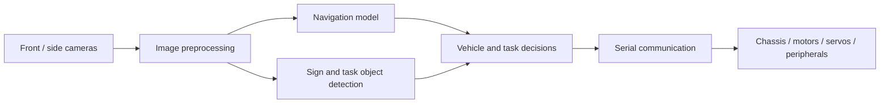

# Smartcar2022 · National First Prize Solution

**2022 Smart Car Competition, China — National First Prize | Visual navigation · Object detection · Task planning · Vehicle and actuator control**

[简体中文](README.zh-CN.md) | **English**

This repository preserves the vehicle-side Python code, exported inference models, PaddleLite bindings, and development variants of a Smartcar2022 National First Prize solution. The system combines front and side camera input, neural network navigation, and object detection with serial control of the chassis, motors, servos, and peripherals to drive the course and perform scene-specific tasks.

The repository is intended for presenting the solution, studying its implementation, and technical discussion. Start reading at [`src/final.py`](src/final.py). The original `bot1.py` and `bot2.py` are byte-for-byte identical to that file and remain in the historical variants directory.

## System overview

| Module | Function | Entry points |
| --- | --- | --- |
| Camera acquisition | Front/side camera capture and threaded frame reading | [`camera.py`](src/camera.py) |
| Autonomous navigation | Image preprocessing, neural steering prediction, differential drive | [`cruiser.py`](src/cruiser.py), [`driver.py`](src/driver.py), [`cart.py`](src/cart.py) |
| Object detection | Signs, people, purchase items, and trade targets | [`detectors.py`](src/detectors.py) |
| Scene tasks | Branches including tower, protect, purchase, trade, and campsite | [`final.py`](src/final.py), [`tasks.py`](src/tasks.py) |
| Peripheral control | Serial protocol, motors, servos, ultrasonic sensor, buttons, lights, and buzzer | [`serial_port.py`](src/serial_port.py), [`widgets_servo_test.py`](src/widgets_servo_test.py) |
| Inference backend | PaddleLite wrapper and a preserved legacy PaddlePaddle interface | [`predictor_wrapper.py`](src/predictor_wrapper.py) |



## Repository layout

```text
Smartcar2022/
├── README.md                    # English documentation
├── README.zh-CN.md              # Chinese documentation
├── src/                         # Main program, configuration, shared modules
├── models/                      # Eight exported model/parameter pairs
├── experiments/
│   ├── integrated/              # Full-flow variants and competition tuning
│   ├── navigation/              # Navigation and driving experiments
│   └── tasks/                   # Individual tasks and recognition experiments
├── tools/
│   ├── run.py                   # Launcher for the reorganized scripts
│   ├── hardware/                # Chassis, servo, button, and camera checks
│   ├── data/                    # Capture and image tools
│   └── validation/              # Historical model validation tools
├── scripts/                     # PaddleLite build helper
├── third_party/                 # PaddleLite SDK, pybind11, ARM64 extension
├── docs/                        # Deployment, file mapping, old performance log
├── archive/                     # Original config, old scripts, damaged files
├── image/                       # Reserved local image directories
└── test/                        # Reserved local validation data directory
```

`image/` and `test/` retain their original relative paths; captured data is ignored by default. Virtual environments, IDE settings, caches, build intermediates, and runtime logs are excluded from Git. Existing local build artifacts are preserved under the ignored `.local/` directory.

## Runtime environment

This archive contains artifacts from an embedded deployment. Running it requires matching vehicle hardware and the board SDK:

- **OS and architecture:** Linux ARM64 (aarch64). The bundled `paddlelite.cpython-35m-aarch64-linux-gnu.so` extension targets the CPython 3.5 ABI.
- **Inference runtime:** the board's PaddleLite / FPGA runtime. The code prioritizes FPGA FP16 / NHWC and also declares Host and ARM execution places; operator availability depends on the SDK.
- **Python dependencies:** NumPy, OpenCV (`cv2`), and pyserial. [`requirements.txt`](requirements.txt) is a dependency inventory, without a verified version lock.
- **Cameras:** `/dev/video0` and `/dev/video1` by default, with 640 × 480 capture.
- **Serial interface:** `/dev/ttyUSB0` by default. The original code uses **380400** baud for `mc601` and 115200 for `wobot`.

A normal Windows / x86 computer can be used to read and statically inspect the code, but cannot directly load the bundled ARM64 extension. Training data, a complete training pipeline, hardware schematics, the board OS image, and FPGA bitstreams are not included.

## Deployment and launch

Run these commands on a matching Linux ARM64 board with its SDK and a working Python environment. Obtain NumPy, OpenCV, and pyserial from the board image or compatible packages first. A current package named PaddleLite should not be assumed to replace the bundled SDK.

```bash
git clone https://github.com/Z13156D2/Smartcar2022.git
cd Smartcar2022

# Make the bundled PaddleLite shared library visible to the dynamic linker.
export LD_LIBRARY_PATH="$PWD/third_party/paddlelite/lib${LD_LIBRARY_PATH:+:$LD_LIBRARY_PATH}"

# Display launcher help without initializing vehicle hardware.
python3 tools/run.py --help
```

After connecting the vehicle and checking camera assignments, serial settings, servo channels, actuator travel, and course parameters, launch the main program:

```bash
python3 tools/run.py src/final.py
```

The launcher adds `src/` and `third_party/runtime/` to the module search path and sets the working directory to the repository root, preserving flat imports and relative data paths. **The main program and some imported modules open serial ports and initialize hardware during import. Hardware scripts may drive actuators directly.**

Use the same launcher for other scripts, for example:

```bash
python3 tools/run.py tools/hardware/camera_position_test.py
python3 tools/run.py experiments/navigation/only_cruiser.py
```

These are historical development programs. Read their device initialization, model dependencies, and motion logic before execution. The original `run.py`, now under `tools/hardware/`, is a servo motion debugging program. The new shared launcher is `tools/run.py`.

## Configuration and models

[`src/config.py`](src/config.py) contains camera assignments, the controller choice, model mappings, class labels, and detection thresholds. Driving speeds, steering gains, servo angles, and timing also appear in `final.py`, `tasks.py`, and other scripts and need calibration when transferring to another vehicle.

Models resolve to this checkout's `models/` directory by default; the original `/home/root/quanguo/` location is no longer required. To use a separate deployment root:

```bash
# Point to the directory that contains the models/ subdirectory.
export SMARTCAR_MODEL_ROOT=/path/to/deployment
```

Eight model groups cover navigation, people, purchase items, signs, tasks, and trade targets. Each contains a `model` and `params` file; see [`models/README.md`](models/README.md). Legacy settings also reference `all_new_p708_ban_f`, `sign707`, `ban`, and `task715`, which were absent from the original project snapshot. Supply those models before using the relevant branches.

## Historical files and reproduction limits

- The original `joystick.py` and `jiuji.py` contain null bytes and cannot be parsed as Python source. Their exact contents are preserved under [`archive/corrupted/`](archive/corrupted/). Capture tools importing `JoyStick` require restoration of that module.
- Historical filenames and tuning values are preserved. Some capture, video, and debugging paths still refer to `/run/media/sda1/` or directories on the original board and need local adaptation.
- [`docs/legacy-performance.md`](docs/legacy-performance.md) is an original performance log. Its model names do not fully match the included model set; it is not a new benchmark of this repository.
- This reorganization was checked for Python syntax, file integrity, documentation links, and path resolution. End-to-end execution on the competition vehicle or board has not been verified.

See [`docs/DEPLOYMENT.md`](docs/DEPLOYMENT.md) for deployment details and [`docs/REORGANIZATION.md`](docs/REORGANIZATION.md) for the file mapping and change record.

## Third-party components and use

Third-party source files, copyright notices, and the pybind11 license are preserved; see [`third_party/README.md`](third_party/README.md). No repository-wide open-source license has been assigned to the original project code or models. Public visibility does not grant unrestricted redistribution or commercial use; contact the project author to confirm permissions.
