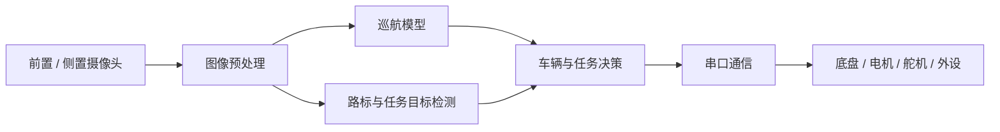

# Smartcar2022 · 智能汽车竞赛国一方案

**2022 智能汽车竞赛全国一等奖方案｜视觉巡航 · 目标识别 · 任务决策 · 车辆与执行机构控制**

**简体中文** | [English](README.md)

本项目整理并保留了 Smartcar2022 国一方案的车端 Python 代码、部署模型、PaddleLite 推理接口和比赛调试版本。系统结合双摄像头视觉输入、神经网络巡航与目标检测，通过串口控制底盘、电机、舵机及其他外设，完成赛道行驶和场景任务。

仓库用于方案展示、代码阅读与技术交流。主程序以 [`src/final.py`](src/final.py) 为阅读入口；原始文件中的 `bot1.py`、`bot2.py` 与它逐字节相同，已保留在历史版本目录。

## 方案概览

| 模块 | 主要内容 | 代码入口 |
| --- | --- | --- |
| 视觉采集 | 前置、侧置摄像头采集；相机线程读取 | [`camera.py`](src/camera.py) |
| 自主巡航 | 图像预处理、神经网络转向量预测、差速控制 | [`cruiser.py`](src/cruiser.py)、[`driver.py`](src/driver.py)、[`cart.py`](src/cart.py) |
| 目标识别 | 路标、人物、采购物品和交易目标检测 | [`detectors.py`](src/detectors.py) |
| 场景任务 | tower、protect、purchase、trade、campsite 等任务分支 | [`final.py`](src/final.py)、[`tasks.py`](src/tasks.py) |
| 外设控制 | 串口协议、电机、舵机、超声波、按键、灯光与蜂鸣器 | [`serial_port.py`](src/serial_port.py)、[`widgets_servo_test.py`](src/widgets_servo_test.py) |
| 推理后端 | PaddleLite 接口封装；保留旧 PaddlePaddle 接口 | [`predictor_wrapper.py`](src/predictor_wrapper.py) |



## 目录结构

```text
Smartcar2022/
├── README.md                    # English documentation
├── README.zh-CN.md              # 中文说明
├── src/                         # 主程序、配置及共用模块
├── models/                      # 8 组已导出的模型与参数
├── experiments/
│   ├── integrated/              # 多版完整流程与赛前调试程序
│   ├── navigation/              # 巡航与行驶参数实验
│   └── tasks/                   # 单项任务与识别实验
├── tools/
│   ├── run.py                   # 整理后的统一脚本启动器
│   ├── hardware/                # 底盘、舵机、按键及相机调试
│   ├── data/                    # 数据采集与图像工具
│   └── validation/              # 历史模型验证工具
├── scripts/                     # PaddleLite 构建辅助脚本
├── third_party/                 # PaddleLite SDK、pybind11 与 ARM64 扩展
├── docs/                        # 部署说明、整理记录及原始性能日志
├── archive/                     # 原配置、旧脚本与损坏原件
├── image/                       # 本地图片预留目录
└── test/                        # 本地模型验证数据预留目录
```

`image/` 和 `test/` 保留原相对路径，实际采集数据默认不提交。虚拟环境、IDE 配置、缓存、构建中间文件和运行日志已加入忽略规则；本地旧构建产物保存在被忽略的 `.local/` 下。

## 运行环境

本仓库包含历史嵌入式部署环境的产物，运行前需要匹配原车硬件及板卡 SDK：

- **系统与架构**：Linux ARM64（aarch64）；随附扩展名为 `paddlelite.cpython-35m-aarch64-linux-gnu.so`，对应 CPython 3.5 ABI。
- **推理环境**：板卡 PaddleLite / FPGA 运行时。代码优先配置 FPGA FP16 / NHWC，同时声明 Host、ARM 执行位置；具体算子支持取决于 SDK。
- **Python 依赖**：NumPy、OpenCV（`cv2`）、pyserial；[`requirements.txt`](requirements.txt) 记录依赖名称，未提供经验证的版本锁定。
- **视觉设备**：默认 `/dev/video0`、`/dev/video1`，图像采集分辨率为 640 × 480。
- **控制接口**：默认 `/dev/ttyUSB0`；`mc601` 使用原代码中的 **380400** 波特率，`wobot` 为 115200。

普通 Windows / x86 电脑适合阅读代码和静态检查，不能直接加载随附 ARM64 扩展。当前仓库不含训练数据、完整训练流程、硬件原理图、板卡系统镜像或 FPGA bitstream。

## 部署与启动

以下命令应在匹配的 Linux ARM64 板卡、原有 SDK 和可用的 Python 环境中执行。先通过板卡镜像或兼容安装包装好 NumPy、OpenCV、pyserial；不要将最新的同名 PaddleLite 包视为随附 SDK 的等价替代。

```bash
git clone https://github.com/Z13156D2/Smartcar2022.git
cd Smartcar2022

# 让动态链接器找到随附的 PaddleLite 共享库。
export LD_LIBRARY_PATH="$PWD/third_party/paddlelite/lib${LD_LIBRARY_PATH:+:$LD_LIBRARY_PATH}"

# 先查看启动器帮助；此命令不会初始化车辆硬件。
python3 tools/run.py --help
```

连接车辆并核对摄像头、串口、舵机通道、动作行程和赛道参数后，启动主程序：

```bash
python3 tools/run.py src/final.py
```

启动器会加入 `src/` 与 `third_party/runtime/` 的模块路径，并将工作目录设为仓库根目录，保留原有扁平导入与相对数据路径。**主程序及部分模块在导入时就会打开串口、初始化硬件；硬件调试脚本也可能直接驱动执行机构。**

其他脚本使用同一启动方式，例如：

```bash
python3 tools/run.py tools/hardware/camera_position_test.py
python3 tools/run.py experiments/navigation/only_cruiser.py
```

这些是历史调试程序，执行前需阅读其设备初始化、模型依赖和动作逻辑。原 `run.py` 已归入 `tools/hardware/`，它是舵机动作调试程序；统一启动器是新建的 `tools/run.py`。

## 配置与模型

主要配置位于 [`src/config.py`](src/config.py)：摄像头、控制器、模型映射、类别标签和检测阈值。完整流程中的速度、转向系数、舵机角度和时序还分布在 `final.py`、`tasks.py` 等文件中，迁移车辆时需要重新标定。

模型默认从当前仓库的 `models/` 读取，无需沿用原来的 `/home/root/quanguo/` 目录。如需使用外部模型根目录：

```bash
# 指向包含 models/ 子目录的目录。
export SMARTCAR_MODEL_ROOT=/path/to/deployment
```

仓库已包含巡航、人物、采购、路标、任务和交易等 8 组模型，每组包含 `model` 与 `params`，详见 [`models/README.md`](models/README.md)。旧配置还引用了未随原项目提供的 `all_new_p708_ban_f`、`sign707`、`ban`、`task715`；使用这些分支需要另行补齐对应模型。

## 历史文件与复现边界

- 原 `joystick.py`、`jiuji.py` 含空字节，无法作为 Python 源码解析，已完整保存在 [`archive/corrupted/`](archive/corrupted/)。依赖 `JoyStick` 的数据采集工具需要先恢复该模块。
- 历史程序保留当时的命名与参数，部分采集、录像和调试路径仍指向 `/run/media/sda1/` 或原板卡目录，需要按实际环境修改。
- [`docs/legacy-performance.md`](docs/legacy-performance.md) 是原项目保留的性能日志，其中模型名与当前模型集合不完全一致，不能作为本仓库的重新测试结果。
- 本次整理完成了源码语法、文件完整性、文档链接及路径检查；未在原比赛车辆或板卡上进行端到端运行验证。

详细部署说明见 [`docs/DEPLOYMENT.md`](docs/DEPLOYMENT.md)，文件迁移与修改记录见 [`docs/REORGANIZATION.md`](docs/REORGANIZATION.md)。

## 第三方组件与使用

第三方源文件、版权声明和 pybind11 许可证均予以保留，见 [`third_party/README.md`](third_party/README.md)。本仓库尚未为原创代码和模型指定统一开源许可证；公开展示不等于授予任意再分发或商业使用许可，相关使用请联系项目作者确认。
